# Apuntes — Redes (IC7602)

> **Avisos:** desde esta semana las clases son **virtuales hasta la semana 15 (martes)**. El **examen** es en la **semana 16 (viernes)**.

* * *

## Trama 802.11 (Wi-Fi)

Una trama Wi-Fi es el "sobre" que viaja por el aire. Cada campo tiene un propósito concreto:

```
+-----------+----------+--------+--------+--------+-----------+--------+---------+-----+
|  Frame    | Duración | Dir. 1 | Dir. 2 | Dir. 3 | Secuencia | Dir. 4 |  Datos  | FCS |
|  Control  |  (NAV)   |        |        |        |           |        |         |     |
+-----------+----------+--------+--------+--------+-----------+--------+---------+-----+
     2 B        2 B       6 B      6 B      6 B       2 B        6 B    0–2312 B  4 B
```

| Campo | ¿Para qué sirve? |
| --- | --- |
| **Frame Control** | Dice qué tipo de trama es (datos, control o administración) y trae varias banderas (ver abajo). |
| **Duración** | Originalmente pensado como "cuánto va a durar la transmisión". En la práctica se usa para el **NAV** (*Network Allocation Vector*): los demás equipos lo leen y saben cuánto tiempo el canal va a estar ocupado, así no transmiten encima. |
| **Direcciones (hasta 4)** | Hay más de dos porque en Wi-Fi existe un intermediario: el **Access Point (AP)**. Se necesita saber el emisor, el receptor inmediato (el AP) y el **destino final** (a donde el AP debe reenviar). |
| **Número de secuencia** | Identifica el fragmento. Sirve para **reensamblar** la trama original y detectar duplicados. |
| **Datos** | La carga útil (lo que viene de la capa de arriba). |
| **FCS** | *Frame Check Sequence* (CRC). Verifica si la trama llegó sin errores. |

### ¿Por qué cuatro direcciones?

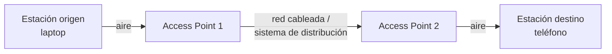

El paquete no va directo de la laptop al teléfono: pasa por uno o más AP. Por eso la trama tiene que guardar **quién lo mandó originalmente**, **quién es el siguiente salto** y **quién es el destino final**.

### Banderas dentro de *Frame Control*

| Bandera | Significado |
| --- | --- |
| **Tipo / Subtipo** | Datos, control (RTS, CTS, ACK) o administración (beacons, asociación). |
| **To DS / From DS** | Si la trama **va hacia** o **viene desde** el sistema de distribución (el AP o la red conectada a él). |
| **More Fragments** | "Todavía faltan fragmentos, espere antes de reensamblar". |
| **Retry** | Es una retransmisión. |
| **Power Management** | La estación va a entrar en modo ahorro de energía (base del *Automatic Power Save Delivery*: el AP guarda las tramas mientras la estación "duerme"). |
| **Protected Frame** | La trama va cifrada. |
| **Order** | La trama debe entregarse en orden estricto a las capas superiores. |

### ¿Por qué fragmentar en Wi-Fi?

El aire es un medio **muy poco confiable** (interferencia, paredes, otros equipos). Si se manda una trama enorme y se daña un solo bit, hay que retransmitir **toda** la trama → se desperdicia mucho ancho de banda.

**Ejemplo:**

| Estrategia | Se daña una parte | Hay que reenviar |
| --- | --- | --- |
| 1 trama de 1500 B | sí | 1500 B |
| 3 fragmentos de 500 B | se daña solo el 2º | 500 B |

El receptor ve la bandera **More Fragments = 1** y se queda esperando; cuando llega el último (bandera en 0) reensambla y sube la trama a la siguiente capa.

* * *

## Servicios de 802.11

Son cosas que usamos todos los días sin darnos cuenta.

| Servicio | Qué hace | Ejemplo cotidiano |
| --- | --- | --- |
| **Asociación** | El dispositivo escanea, encuentra redes y se conecta a un AP. | Abrir el Wi-Fi del teléfono y elegir una red. |
| **Reasociación** | Cambiarse de un AP a otro **de la misma red** (mismo SSID). | Caminar por el TEC sin perder conexión. |
| **Desasociación** | Desconectarse del AP. | Apagar el Wi-Fi. |
| **Autenticación** | Verificar que el equipo puede entrar. | WEP (obsoleto), WPA, WPA2 Personal/Enterprise, WPA3. |
| **Distribución** | El AP decide cómo hacer llegar la trama (actúa como "router" del lado inalámbrico). | — |
| **Integración** | Conectar la red inalámbrica con redes de otro tipo (cableada, microondas, etc.). | Tu laptop por Wi-Fi le habla a un servidor por cable. |
| **Entrega de datos** | Garantiza que los datos lleguen pese a un medio con muchísimos errores (ACKs y retransmisiones). | — |
| **Privacidad** | Cifrado de las comunicaciones. | — |
| **Programación de tráfico (QoS)** | Prioriza tráfico sensible al tiempo. | Llamadas VoIP / streaming antes que un correo. |
| **Control de potencia** | Ajusta la potencia → ajusta el área de cobertura. | — |
| **Selección dinámica de frecuencia (DFS)** | Analiza los canales y escoge el más libre. | Routers modernos que "se acomodan" solos. |

### Reasociación: cómo funciona en el TEC

```
          Área de cobertura de cada AP (mismo SSID: "TEC")

        .-----.        .-----.        .-----.
      /  AP1   \     /  AP2   \     /  AP3   \
     |          |---|          |---|          |
      \        /     \        /     \        /
        '-----'        '-----'        '-----'
           |              |              |
           +-------- Switch (PoE) -------+

    ───────────────►───────────────►
   Asociado a AP1   Reasocia a AP2   Reasocia a AP3
```

- Todos los AP están conectados a un **switch físico**; los modernos reciben corriente por el mismo cable (**PoE, Power over Ethernet**).
- Como todos exponen el **mismo SSID y la misma clave**, el teléfono puede saltar al AP más cercano.
- **¿Por qué cambiarse?** Por la **adaptación de tasa**: si la señal es débil, el equipo transmite más lento. Pasarse al AP más cercano = mejor señal = más velocidad.

 si comprás otro AP, le ponés el **mismo SSID y la misma clave**, los dispositivos se mueven solos entre ambos.

### Prueba práctica sugerida por el profe

1. Conectate por Wi-Fi y entrá a **fast.com**.
2. Medí al lado del AP, en otro cuarto y detrás de una pared de concreto.
3. Repetí con cable.

**Resultado esperado:** cable > Wi-Fi cerca del AP > Wi-Fi lejos/detrás de paredes. Menos interferencia → la adaptación de tasa sube la velocidad.

### QoS: la cola de prioridad

Los paquetes que llegan a un AP/router se guardan en un **buffer**. Con QoS ese buffer se comporta como una **cola de prioridad**:

```
Llegan:   [correo] [VoIP] [web] [VoIP] [descarga]

Cola normal (FIFO):      correo → VoIP → web → VoIP → descarga
Cola de prioridad (QoS): VoIP → VoIP → web → correo → descarga
```

Protocolos de tiempo real (como **RTP**, pensado originalmente para VoIP) se marcan para que salgan primero.

### Anécdota: los canales de fábrica

Antes, todos los AP baratos venían configurados en **el mismo canal**. Con muchos vecinos en el mismo canal, la conexión era mala; bastaba con **cambiar manualmente el canal**. Hoy la **selección dinámica de frecuencia** lo hace automáticamente.

### Anécdota: por qué WEP era débil

El ataque clásico consistía en: capturar tráfico con un sniffer, **clonar la MAC** de un equipo legítimo, forzar una **re-autenticación**, y capturar el intercambio de credenciales del equipo real. Era un protocolo débil; lo que lo "protegía" era que antes se necesitaba equipo especializado. Por eso hoy se usa WPA2/WPA3.

* * *

## WiMAX (802.16)

Protocolo de **banda ancha inalámbrica de largo alcance**. Hoy está prácticamente muerto, pero tenía mucho potencial (se usó en Costa Rica alrededor de 2012–2014).

### Arquitectura

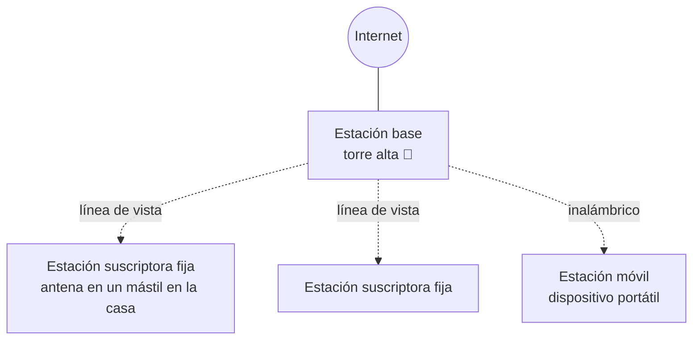

- **Estación base:** torre muy alta (la idea es tener **línea de vista** a toda una región aunque el terreno sea irregular).
- **Estación suscriptora fija:** antena direccional en un mástil (~2–2.5 m) en el techo de la casa.
- **Estación móvil:** un dispositivo pequeño portátil (el profe lo usaba caminando de Sabana Sur a la parada de buses de Cartago viendo Netflix ).
- Velocidades de la época: ~**60 Mbps** en fijo, muy bueno para entonces.

### Características técnicas (según la clase)

| Aspecto | Detalle |
| --- | --- |
| Espectro | Rango aproximado de 1 a 11 GHz |
| Canales | Anchos de pocos MHz hasta ~20 MHz (fijo vs. móvil) |
| Ancho de banda **bajo demanda** | Si necesitás más, mandás una solicitud y el sistema te asigna más. |
| Tipo de servicio | **Orientado a conexión** (cada conexión tiene un ID) |

### Dos formas de compartir el canal

```
TDD (Time Division Duplex) — mismo canal, se turnan en el tiempo
tiempo ─►  [ SUBIDA ][ BAJADA ][ SUBIDA ][ BAJADA ] ...

FDD (Frequency Division Duplex) — frecuencias distintas, al mismo tiempo
frecuencia A: [ SUBIDA  SUBIDA  SUBIDA  SUBIDA  ... ]
frecuencia B: [ BAJADA  BAJADA  BAJADA  BAJADA  ... ]
```

- **TDD:** uso el canal completo, pero mitad del tiempo envío y mitad recibo.
- **FDD:** divido el canal (ej. una parte para subida y otra para bajada) y envío y recibo **simultáneamente**.

### Tramas de WiMAX

Muy simples:

- **Trama genérica:** bit inicial en 0, bandera de cifrado, qué clave de cifrado se usa, longitud, **ID de conexión**, CRC del **encabezado** separado del CRC de los **datos**.
- **Trama de solicitud de ancho de banda:** tipo, **bytes requeridos**, ID de conexión y CRC del encabezado.

### ¿Por qué murió WiMAX?

1. Las frecuencias que usaba son las mismas que usan las **redes celulares (4G/5G)**.
2. Las operadoras celulares son mucho más poderosas económicamente.
3. A los gobiernos les convenía más **subastar** esas frecuencias para 5G a varias operadoras que dejarlas a una sola empresa de WiMAX.
4. La gente usa celulares, no módems WiMAX → presión política para dedicar ese espectro a telefonía.

* * *

## Capa de Red: conmutación por almacenamiento y reenvío

### Recordatorio del viaje entre capas

```
Capa superior  →  datos
Capa de red    →  PAQUETES
Enlace         →  TRAMAS   (en Wi-Fi, además se parten en FRAGMENTOS)
Física         →  bits por el medio
```

Cada vez que un paquete pasa de un router a otro se dice que da un **salto (hop)**. La red se ve como un **grafo**: los routers son nodos y los enlaces son aristas (igual que en Estructuras de Datos).

### Store-and-forward (conmutación por almacenamiento)

Un router de capa 3 **no reenvía bits a medida que llegan**. Hace esto:

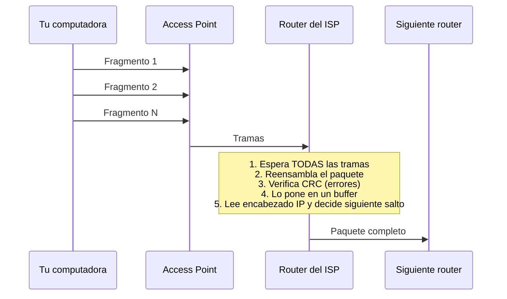

**Ejemplo:** mandás un paquete de 1 MB al router de tu proveedor. El router **espera** a que lleguen todas las tramas, arma el paquete, revisa que no tenga errores, lo deja en una **cola (buffer)** y, cuando le toca, el algoritmo del router lee la información de capa 3 y decide el siguiente salto.

> IS-IS es un caso curioso: es un protocolo de enrutamiento que **no corre sobre IP**, sino directamente sobre la capa de enlace (capa 2). Aun así, se estudia como protocolo de capa 3 porque su trabajo es enrutar.

* * *

## Servicio sin conexión vs. orientado a conexión

### Sin conexión (red de datagramas) — ej. IP

Cada paquete (llamado **datagrama**) viaja **de forma independiente** con su dirección de origen y destino.

**Analogía de la mudanza a Guanacaste:** varios amigos llevan tus cosas, cada uno en su carro. Salen al mismo tiempo, pero uno se va por San Carlos, otro directo, otro por otra ruta. Todos llegan, pero **no en el orden en que salieron**.

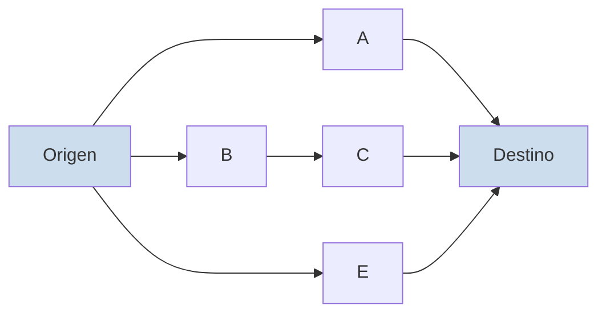

-  **Ventaja: adaptabilidad.** Si un router se cae o hay un "choque", los paquetes buscan otra ruta (como Waze, pero recalculando por cada paquete).
-  Paquetes pueden llegar **desordenados** (alguno toma la "ruta panorámica").
-  **No sé si hay capacidad** en la red: simplemente salgo y veo qué pasa → riesgo de **congestión**.

### Orientado a conexión (circuitos virtuales)

**Antes** de enviar datos se **establece una ruta** pidiendo permiso a cada router.

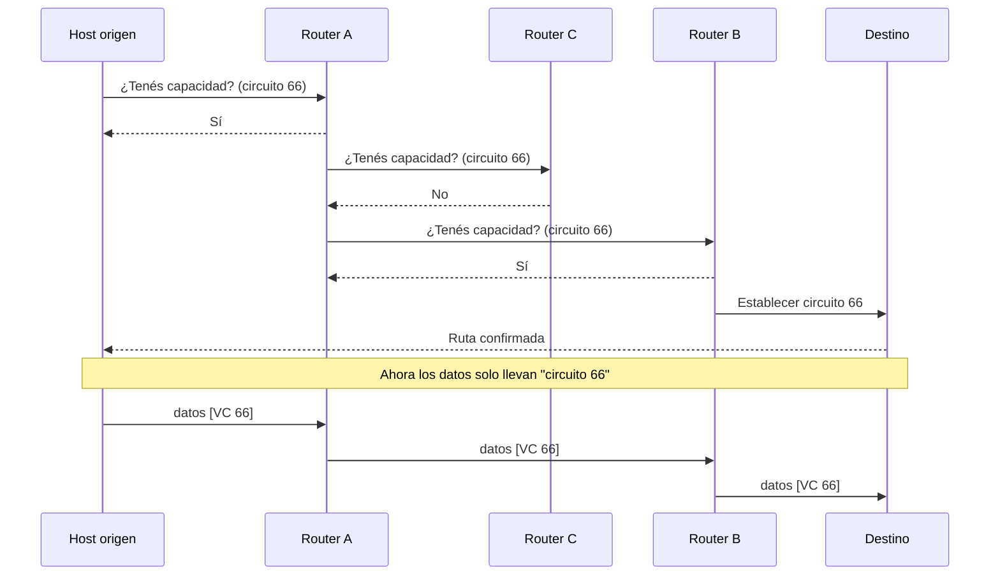

Cada router guarda una tabla: *"lo que venga por el circuito 66 lo saco por el router B"*.

**Analogía de la autopista:** llamás antes y preguntás "¿hay espacio para mi carro?". Si ya hay 10 conexiones y viene la 11 y el router no da abasto, **la rechaza** para no causar congestión.

-  **Control de capacidad / QoS:** se reservan recursos.
-  Paquetes llegan **en orden** (misma ruta).
-  Si se cae un router de la ruta, **todo el circuito falla** y hay que restablecerlo.

### Tabla comparativa

| Aspecto | Datagramas (sin conexión) | Circuitos virtuales |
| --- | --- | --- |
| Establecer conexión | No | Sí |
| Direccionamiento | Origen y destino completos en cada paquete | Solo un número de circuito virtual |
| Estado en routers | No guardan nada por conexión | Guardan los circuitos que atienden |
| Ruta | Cada paquete puede ir por una distinta | Todos siguen la misma |
| Si falla un router | Se pierden algunos, se reenvían por otra ruta | El circuito falla |
| Calidad de servicio | Difícil | Fácil (reserva de recursos) |
| Congestión | Problema serio | Controlable (rechazo de conexiones) |
| Ejemplo | Internet (IP) | ATM, MPLS, WiMAX |

* * *

## Algoritmos de enrutamiento

Un **algoritmo de enrutamiento** es el software del router que **decide por qué línea de salida mandar cada paquete**. Tiene dos procesos:

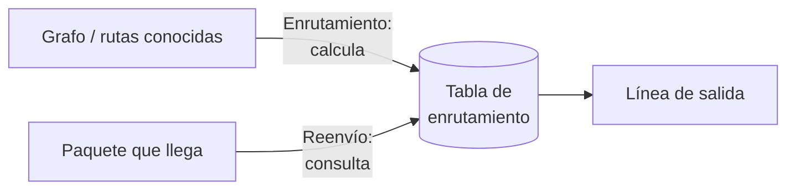

- **Enrutamiento:** toma el grafo y **genera la tabla** (proceso "lento", ocurre de vez en cuando).
- **Reenvío (forwarding):** por cada paquete que llega, **consulta la tabla** y escoge la salida (tiene que ser rapidísimo).

### Características deseadas

| Característica | Por qué importa |
| --- | --- |
| **Exacto** | Si se equivoca, el paquete se pierde. |
| **Sencillo** | Cada milisegundo de decisión suma retardo. |
| **Robusto** | No se puede caer. |
| **Estable** | Converge, no oscila entre rutas. |
| **Justo (equidad)** | Todos reciben el mismo servicio. |
| **Eficiente** | Buen uso de la red. |
| **Manejar cambios de topología** | Aparecen/desaparecen routers, cambian las métricas. |

**Ejemplo de por qué debe ser sencillo:**

```
10 ms por router × 20 routers = 200 ms de retardo
```

- > ~80 ms ya se considera excesivo.
  
- > 100–120 ms la gente **nota** que la red está lenta.
  

**Métrica común: RTT (round-trip time)**, el tiempo de ida y vuelta (lo usaron en el Proyecto 1). Dividido entre dos da una estimación del tiempo de un solo sentido. Si el RTT empieza a subir → hay un problema en ese tramo de la red.

### No adaptativos vs. adaptativos

|  | No adaptativo (estático) | Adaptativo (dinámico) |
| --- | --- | --- |
| ¿Usa datos de la red? | No | Sí, mide y actualiza |
| ¿Cambia la ruta? | No (la configura alguien) | Sí, recalcula con nuevos pesos |
| Ejemplo | La tabla de rutas de tu computadora (`ip route`), la de la tarea corta | RIP, OSPF, IS-IS, BGP |

### Principio de optimalidad

> Si el router **J** está en la ruta óptima de **I** a **K**, entonces el tramo de **J** a **K** dentro de esa ruta **también es óptimo**.

```
Ruta óptima de I a K:   I ──► X ──► J ──► Y ──► K
                                     └───────────┘
                         este tramo es la ruta óptima de J a K
```

(Si existiera un camino más corto de J a K, podríamos usarlo para mejorar la ruta de I a K, lo cual contradice que fuera óptima.)

### Árbol sumidero (*sink tree*)

Si juntamos **las rutas óptimas de todos los routers hacia un mismo destino**, se forma un árbol con raíz en el destino:

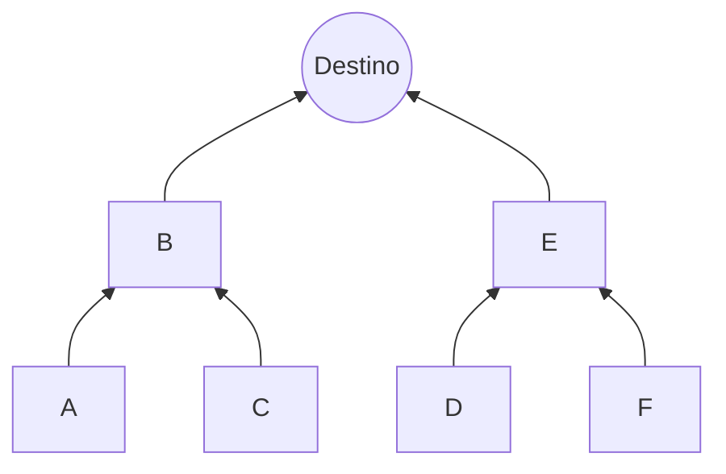

- No es necesariamente **único** (puede haber empates) y **cambia en el tiempo**.
- No tiene ciclos → un paquete llega en un número finito de saltos.

### ¿Por qué no basta con Dijkstra sobre todo Internet?

Los algoritmos clásicos de ruta más corta (**Dijkstra**, **Floyd-Warshall**) asumen que **conocés todo el grafo**. En Internet eso no es práctico:

1. **Cantidad de nodos enorme:** cualquiera puede montar un servidor/router.
2. **Muchísimas actualizaciones por minuto** (routers que aparecen, desaparecen, congestión).
3. **El aviso viaja por la misma red congestionada.** No es como Waze, que usa otro canal: es como si en una presa tuvieras que avisar de la presa usando la misma carretera trancada.

**Solución:** dividir la red en **áreas o niveles** y aplicar Dijkstra **dentro** de cada área pequeña.

* * *

## Inundación (flooding)

Un router, al arrancar, **no sabe quién está conectado a él**. Solo puede "sentir" a sus vecinos directos.

**Analogía de la sala con ojos vendados:** yo detecto a una persona a mi izquierda a 4 m y a Luis Fernando a mi derecha a 2 m. Luis Fernando detecta a otra persona a 5 m. Cuando nos contamos lo que cada uno "siente", entre todos armamos el mapa completo del cuarto.

### Cómo funciona

Cuando un router detecta un **evento significativo** (llega un router nuevo, se va uno, cambia un peso):

1. Manda un mensaje **por todas sus líneas** (menos por la que le llegó).
2. Cada router que lo recibe hace lo mismo.
3. Toda la red se "inunda" con el aviso → todos actualizan su grafo.

```
Paso 0:        Paso 1:            Paso 2:
   [R1]*         [R1]─►[R2]*        [R2]─►[R4]*
                 [R1]─►[R3]*        [R3]─►[R4]  (duplicado → se descarta)
                                    [R3]─►[R5]*
```

### Problema: ¡es un grafo, hay ciclos!

Un mensaje podría quedar dando vueltas para siempre. Se evita con:

| Mecanismo | Cómo funciona |
| --- | --- |
| **Contador de saltos / TTL** | Cada salto decrementa un contador; al llegar a 0 se descarta. |
| **ID + número de secuencia** | Cada router recuerda el último número que procesó de cada origen. Si llega uno **más viejo o repetido**, lo descarta (útil cuando un mensaje viejo tomó la "ruta panorámica" y llega después de uno más nuevo). |

> La inundación se usa para los **paquetes de control** (armar el grafo), no para los datos normales.

* * *

## RIP — Vector de distancia (Bellman-Ford)

**RIP (Routing Information Protocol).** Cada router:

1. Mide la distancia a sus **vecinos directos** (con un paquete **ECHO**: va y vuelve, se mide el tiempo; o simplemente cuenta saltos).
2. Tiene una tabla indexada por cada destino: **distancia estimada** y **por quién salir**.
3. **Comparte su tabla solo con sus vecinos**, periódicamente.
4. Con las tablas de los vecinos recalcula: `dist(yo→X) = min sobre vecinos V de [ dist(yo→V) + dist(V→X) ]`.

### Ejemplo trabajado

Topología (pesos en ms):

```
        10
   A ─────── B
   │         │
 20│         │5
   │         │
   C ─────── D
        10
```

**Tablas iniciales** (cada uno solo conoce a sus vecinos):

| Router | Destino | Distancia | Salir por |
| --- | --- | --- | --- |
| A | B | 10 | B |
| A | C | 20 | C |
| B | A | 10 | A |
| B | D | 5 | D |
| C | A | 20 | A |
| C | D | 10 | D |
| D | B | 5 | B |
| D | C | 10 | C |

**Ronda 1 — intercambian tablas con vecinos:**

- **A → D:** vía B = 10 + 5 = **15**; vía C = 20 + 10 = 30 → **15 por B**
- **B → C:** vía A = 10 + 20 = 30; vía D = 5 + 10 = **15** → **15 por D**
- **C → B:** vía A = 20 + 10 = 30; vía D = 10 + 5 = **15** → **15 por D**
- **D → A:** vía B = 5 + 10 = **15**; vía C = 10 + 20 = 30 → **15 por B**

**Ronda 2:**

- **A → C:** directo = 20; vía B = 10 + 15 = 25 → se queda **20 directo**.
- Nada más cambia → **la red convergió**.

Tabla final de A:

| Destino | Distancia | Salir por |
| --- | --- | --- |
| B | 10 | B |
| C | 20 | C |
| D | 15 | B |

> En vector de distancia **nadie ve el grafo completo**; cada uno solo sabe "a qué distancia está cada destino y por qué vecino ir" (de ahí el nombre).

* * *

## Estado de enlace: OSPF

### Vector de distancia vs. estado de enlace

|  | Vector de distancia (RIP) | Estado de enlace (OSPF, IS-IS) |
| --- | --- | --- |
| ¿Qué se comparte? | Mi tabla completa de distancias | Solo mis enlaces directos y sus costos |
| ¿Con quién? | Solo con vecinos | Con **todos** (por inundación) |
| ¿Qué conoce cada router? | Distancias y siguiente salto | **El grafo completo** (de su área) |
| Cálculo | Bellman-Ford distribuido | **Dijkstra** local |

### El problema que resuelve OSPF

En una organización grande (ej. el TEC) el grafo crece tanto que **cada router gastaría mucha memoria y tiempo** corriendo Dijkstra sobre todo → más retardo.

**Analogía de Waze:** si para calcular tu ruta en San José, Waze usara el tráfico de toda Latinoamérica, tardaría muchísimo... y el tráfico de Ciudad de México no tiene nada que ver con el tuyo.

### Áreas en OSPF

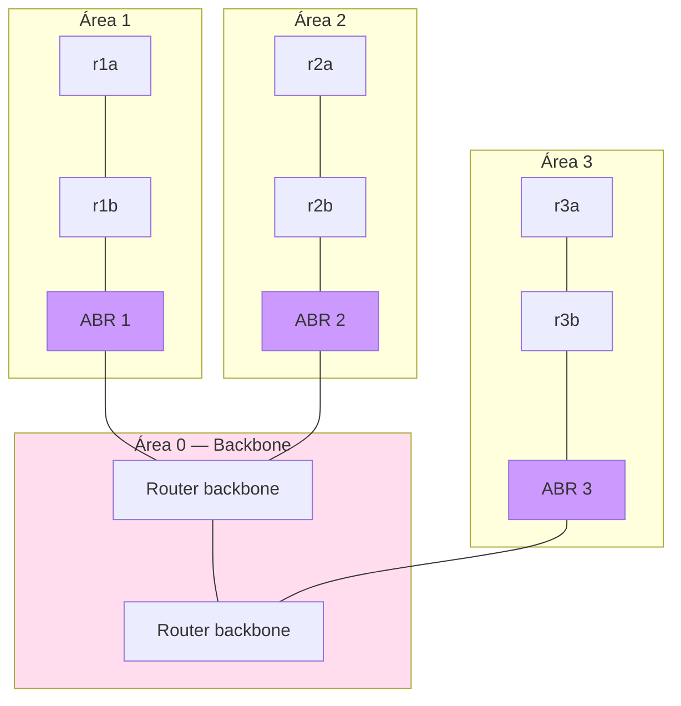

- **Área 0 (backbone):** la columna vertebral, sabe cómo conectar todas las áreas.
- **Áreas 1, 2, 3…:** se agrupan routers que **intercambian mucho tráfico entre sí** (ej. todas las máquinas de Financiero Contable en el área 4).
- **ABR (Area Border Router):** router de borde que conecta un área con el backbone.

### Pasos dentro de un área

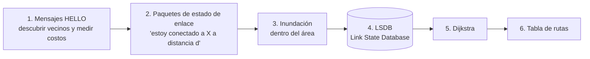

### ¿Y si el destino está en otra área?

1. Dijkstra dentro del área lleva el paquete hasta el **ABR**.
2. En el backbone corre **otro** cálculo de rutas (entre ABRs).
3. Se entrega al ABR del área destino, que lo enruta localmente.

**Resultado:** el tráfico se segrega y las decisiones son mucho más rápidas. OSPF corre sobre IP (capa 3) y es muy usado **dentro de empresas**.

* * *

## IS-IS (Intermediate System to Intermediate System)

Muy parecido a OSPF (también es de estado de enlace), con diferencias clave:

### Niveles en vez de áreas

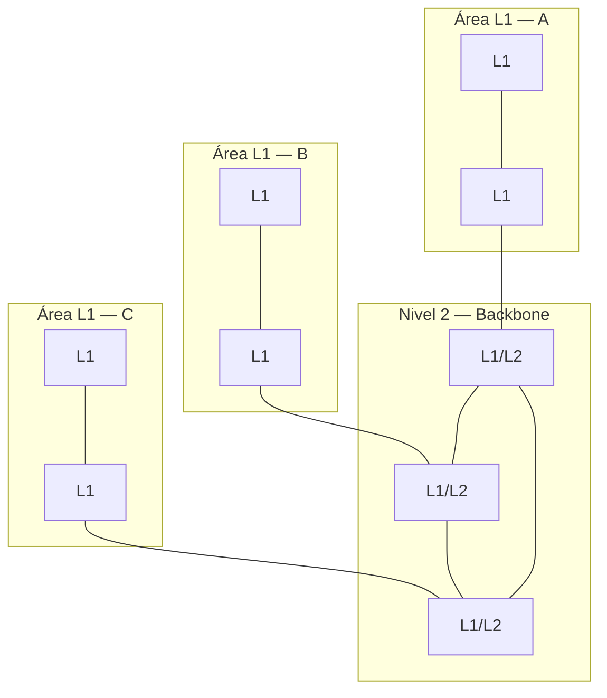

| Tipo de router | Rol |
| --- | --- |
| **L1** | Enrutamiento **interno** del área (su propio grafo). Descubre vecinos con mensajes *Hello* de nivel 1. |
| **L2** | Comunicación **entre áreas** (backbone). |
| **L1/L2** | Hace las dos cosas: es el "router de borde". |

### Diferencia importante con OSPF: la conectividad del backbone

- **OSPF:** todo el tráfico entre áreas pasa por **un backbone central (área 0)**.
- **IS-IS:** los routers L1/L2 pueden conectarse **directamente entre sí**, formando su propio grafo.

**Analogía de carreteras:**

```
OSPF (todo pasa por el centro)         IS-IS (conexiones directas)

  Cartago ──► San José ──► Heredia       Cartago ─────────► Heredia
                 ▲                           \              /
  Alajuela ──────┘                            ─► Alajuela ◄─
```

Si para ir de Cartago a Heredia **siempre** hay que pasar por San José, todo se tranca ahí. Con carreteras directas entre ciudades, la ruta es más rápida.

### Otras diferencias

|  | OSPF | IS-IS |
| --- | --- | --- |
| Corre sobre | IP (capa 3) | Directamente sobre capa 2 |
| Organización | Áreas alrededor del área 0 | Niveles L1 / L2 |
| Identifica | Routers (router ID) | Sistemas (intermedios / finales) |
| Uso típico | Empresas, campus | **Proveedores de Internet (ISP)** |

* * *

##  BGP (Border Gateway Protocol)

### Sistema autónomo (AS)

Una **red en sí misma**, administrada por una sola organización (un ISP, una cablera, una universidad grande). **Por dentro** puede usar el protocolo que quiera (OSPF, IS-IS…).

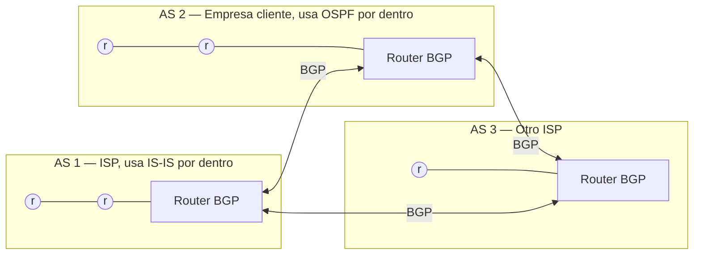

### Lo distintivo: enrutamiento basado en **políticas**

BGP no busca solo "el camino más corto". Decide según **reglas** del administrador:

- Políticas **comerciales**: "prefiero salir por el proveedor X porque es más barato".
- Políticas **públicas/legales**: "Este tráfico no debe pasar por cierto país".
- Acuerdos entre redes: "No dejo que el tráfico de mi competidor pase por mi red".

**Resumen de la jerarquía:**

```
Dentro de un área/empresa  →  OSPF
Dentro de un ISP           →  IS-IS (o OSPF)
Entre sistemas autónomos   →  BGP
```

* * *
