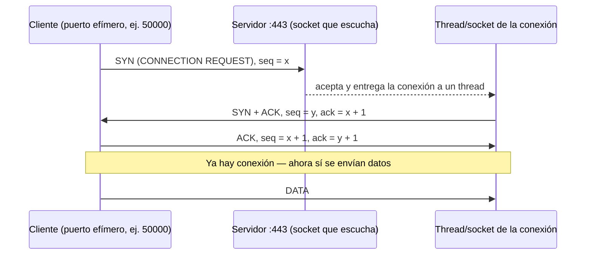

# Resumen de Clase 03/11/2026 Redes Emily Sánchez Orozco - 2021067314

## 1. TCP vs UDP

La capa de transporte tiene dos protocolos principales:

| | **TCP** | **UDP** |
|---|---|---|
| Orientado a conexión |  Sí (handshake) |  No |
| Garantiza entrega |  Sí (timeouts + retransmisiones) |  No ("que pase lo que tenga que pasar") |
| Orden |  Garantizado |  No |
| Costo en recursos | Alto | Bajo |
| Latencia inicial | Alta | Mínima |

### Idea clave de la clase

La confiabilidad **no desaparece** cuando se usa UDP: simplemente **se mueve de capa**.

```
            Con TCP                                Con UDP (ej. DNS)
 ┌──────────────────────────┐          ┌──────────────────────────────────┐
 │ Aplicación               │          │ Aplicación                       │
 │                          │          │   timeouts +  reintentos         │ ← la lógica de
 │                          │          │  (la app decide qué hacer)       │   confiabilidad
 ├──────────────────────────┤          ├──────────────────────────────────┤   vive AQUÍ
 │ Transporte (TCP)         │          │ Transporte (UDP)                 │
 │   timeouts +  retries    │ ← AQUÍ   │  (solo envía)                    │
 ├──────────────────────────┤          ├──────────────────────────────────┤
 │ Red, enlace, física...   │          │ Red, enlace, física...           │
 └──────────────────────────┘          └──────────────────────────────────┘
```

- **TCP** → la confiabilidad (timeouts, retransmisiones, números de secuencia) es responsabilidad de la **capa de transporte**.
- **UDP** → si la aplicación necesita confiabilidad, la implementa **ella misma en la capa de aplicación**.

> Un error común es pensar que UDP es confiable porque DNS casi siempre funciona. DNS es confiable porque **el resolver** maneja timeouts y reintentos, no porque UDP garantice nada.

---

## 2. Puertos y recursos del sistema operativo

Cada conexión consume recursos del SO, tanto del lado del cliente como del servidor:

-  **Memoria** (buffers del socket, estructuras del kernel)
-  **CPU**
-  **File descriptors** (cada socket es un FD)
-  **Puertos**

### Well-Known Ports

Son puertos con un uso ya "adquirido" por convención; no se espera que otro protocolo pase por ahí.

| Puerto | Servicio |
|---|---|
| 21 | FTP (File Transfer Protocol) |
| 22 | SSH (sesión remota a un sistema Linux) |
| 53 | DNS (UDP y TCP) |
| 443 | HTTPS |

- Los well-known ports están en el rango bajo (**0–1023**).
- En transporte hay **65 536 puertos** posibles (16 bits: 0–65535) por protocolo.
- Para conexiones salientes (puertos **efímeros**) se usan rangos altos. El profe mencionó "arriba de ~30K" como estándar de facto.
  - Referencia: Linux usa `32768–60999`; IANA recomienda `49152–65535`.
  - Resultado práctico: hay **~30–35K puertos disponibles** para abrir sockets salientes.

### Ejemplo: el router con NAT como cuello de botella

```
  1000 máquinas ──┐
  (red local)     ├──► [ Router NAT ] ──► Internet
                  │     1 IP pública
  ...           ──┘     ~65K puertos para mapear
```

Si 1000 máquinas abren en promedio 64 conexiones cada una:

```
1000 × 64 = 64 000 mapeos  →  casi todos los puertos del router
```

El router se vuelve el recurso limitante: **todas comparten los mismos ~65K puertos** (y en la práctica menos, porque los bajos están reservados).

---

## 3. Establecimiento de conexión TCP (3-way handshake)

Escenario: un cliente se conecta a un servidor HTTPS en el puerto 443. El servidor tiene un socket "escuchando" y un pool de threads que atienden las conexiones.



Pasos:

1. El cliente pide conectarse con un **número de secuencia inicial `x`** (aleatorio).
2. El servidor acepta, le pasa el trabajo a un **thread** y se crea un **socket nuevo** para esa conexión (lo que devuelve `accept()`).
3. El servidor confirma con **su propio número de secuencia `y`** y acusa `x`.
4. El cliente confirma `y`. A partir de aquí van los datos.

> El socket nuevo que devuelve `accept()` sigue usando el puerto local 443. Lo que distingue una conexión de otra es la **4-tupla** `(IP origen, puerto origen, IP destino, puerto destino)`. El socket que escucha en 443 solo hace el "recibimiento" y queda libre para la siguiente conexión.

---

## 4. ¿Por qué TCP es "caro"? Latencia y recursos

### Latencia

Supongamos **60 ms** por trayecto (RTT = 120 ms) y **40 ms** de procesamiento en el servidor.

```
TCP                                         UDP
───                                         ───
SYN           →   60 ms                     Petición   →  60 ms
SYN+ACK       ←   60 ms                     Proceso       40 ms
ACK + petición →  60 ms                     Respuesta  ←  60 ms
Proceso           40 ms                     ─────────────────────
Respuesta     ←   60 ms                     Total:       160 ms
─────────────────────────
Total:           280 ms   (+ cierre de conexión con FIN)
```

Con TCP hay **un RTT completo extra** solo para establecer la conexión, antes de mandar un solo byte útil. Además, cada bloque de datos necesita confirmación (ACK).

### Recursos

Mientras la conexión esté abierta, el thread y el socket **siguen ocupando** memoria, CPU, file descriptors y puertos. Entre más conexiones, más recursos:

```
Conexiones abiertas ↑  ⇒  memoria ↑, CPU ↑, FDs ↑, puertos ↑
```

Límites físicos del servidor: memoria, CPU, cantidad de FDs y puertos.

###  Relación con ataques DoS / DDoS

Esta es la base de los ataques de **denegación de servicio**: crear conexiones y más conexiones (sockets + threads) para agotar CPU, memoria y file descriptors.

```
Atacante:  crear → crear → crear → crear ...
Servidor:  lista de procesos enorme, CPU ≈ 100 %, FDs agotados
Cliente legítimo intenta conectarse  →   el sistema no responde
```
---

## 5. ¿Por qué DNS usa UDP?

DNS es un protocolo de **capa de aplicación** que puede operar sobre **UDP o TCP**, pero normalmente usa **UDP (puerto 53)**.

Con UDP:

-  No hay que crear un socket nuevo por cliente
-  No hay que crear un thread por cliente
-  No hay números de secuencia que confirmar
-  No hay protocolo de establecimiento

El servidor **recibe el mensaje, lo procesa y responde**. Listo.

### Ejemplo: Google DNS

Si un servidor DNS público funcionara solo con TCP y pudiera mantener, digamos, ~60 000 conexiones simultáneas... ¡atiende muchísimas más consultas que eso! Y no solo de personas: cada casa tiene varios dispositivos haciendo consultas.

>   DNS **se podría** montar sobre TCP, pero **operativamente no tiene sentido**. Por eso se prefiere UDP y se deja la confiabilidad (timeouts y reintentos) al **cliente/resolver** en la capa de aplicación. Así, con el mismo hardware, se atienden muchos más clientes.

>  Dato útil para el proyecto de DNS: DNS sí usa TCP en casos específicos, como respuestas grandes que no caben en un datagrama UDP o transferencias de zona.

---

## 6. Liberación de conexión y casos de pérdida

TCP está preparado para lidiar con mensajes perdidos o duplicados porque cada socket lleva el registro de los números de secuencia que está usando.

### En el establecimiento

- **Petición duplicada/retrasada:** si el socket del cliente reintenta porque expiró su timer, y la petición vieja llega después, el servidor detecta que ese número de secuencia ya está en uso y **rechaza** la duplicada.
- **Se pierde la confirmación:** el socket se queda esperando y **reenvía** hasta recibirla.

### En la desconexión (DR = *Disconnection Request*)

```
Caso 1: Normal                     Caso 2: Se pierde el ACK final
Host 1          Host 2             Host 1          Host 2
  │── DR ──────►│                    │── DR ──────►│
  │◄────── DR ──│ (inicia timer)     │◄────── DR ──│ (inicia timer)
  │── ACK ─────►│                    │── ACK ──X  │
  liberar     liberar                liberar        expira → libera
```

```
Caso 3: Se pierde la respuesta     Caso 4: Se pierde todo (red caída)
Host 1          Host 2             Host 1          Host 2
  │── DR ──────►│                    │── DR ──────►│
  │   X ── DR ──│                    │   X ── DR ──│
   expira                              expira
  │── DR ──────►│ (reintento)        │── DR ──X    │ (reintentos...)
  │◄────── DR ──│                     se agotan     expira
  │── ACK ─────►│                    timers y         → libera
  liberar     liberar                reintentos
                                     → libera
```
---

## 7. Servicios de la capa de transporte

| Mecanismo | Para qué sirve |
|---|---|
| **Checksum** (suma de verificación) | Verificar que el paquete llegó sin corrupción |
| **Números de secuencia** | Ordenar los segmentos, saber cuál es el último y reensamblar |
| **Números de confirmación (ACK)** | Indicar qué se recibió |
| **ARQ** (*Automatic Repeat reQuest*) | Si un segmento no se confirma antes del timeout, se retransmite |
| **Ventana deslizante** | Enviar varios segmentos sin esperar ACK por cada uno |

### Parada y espera vs ventana deslizante

```
Parada y espera (stop-and-wait)         Ventana deslizante (ventana = 4)
Emisor        Receptor                  Emisor        Receptor
  │── 1 ─────►│                           │── 1 ─────►│
  │◄──── ACK1 │                           │── 2 ─────►│
  │── 2 ─────►│                           │── 3 ─────►│
  │◄──── ACK2 │                           │── 4 ─────►│
  │── 3 ─────►│                           │◄──── ACK  │
  (bloquea esperando cada ACK)            (sigue enviando dentro de la ventana)
```

---

## 8. Multiplexación y multiplexación inversa

### Multiplexación

**Compartir una conexión entre varias aplicaciones/conexiones.**

En tu computadora corren varias aplicaciones a la vez (browser, WhatsApp, Slack...). Todas salen por la misma tarjeta de red, cada una con su socket:

```
 ┌───────────┐  ┌───────────┐  ┌───────────┐
 │ Browser   │  │ WhatsApp  │  │ Slack     │
 │ socket 1  │  │ socket 2  │  │ socket 3  │
 └─────┬─────┘  └─────┬─────┘  └─────┬─────┘
       └──────────────┼──────────────┘
                ┌─────┴─────┐
                │ Buffers del SO (compartidos) │  ← guarda segmentos de TODOS los
                └─────┬─────┘                    sockets activos hasta poder
                      │                          reensamblarlos
                 Una sola conexión de red
```

Los segmentos llegan **desordenados, incompletos o por rutas distintas**, así que el SO los guarda en buffers hasta tener el paquete de aplicación completo. Ese almacenamiento se **comparte** entre múltiples conexiones y aplicaciones.

### Multiplexación inversa

**Usar varias conexiones para una sola comunicación.**

Ejemplo: en casa tienes dos proveedores, 8 Mbps cada uno → en teoría **16 Mbps** totales.

```
                     ┌── Proveedor A (cable) 8 Mbps ──┐
 [Casa] ─ [Router] ──┤                                 ├── Internet ── [Google Drive]
                     └── Proveedor B (otro) 8 Mbps ───┘
```

¿Cómo se usan normalmente esas dos conexiones?

| Estrategia | Cómo funciona | Problema |
|---|---|---|
| **Failover** | Ruta principal + ruta de respaldo. Si la principal falla, se pasa a la otra. (Puede ser algo barato como un celular de respaldo.) | La ruta de respaldo se **desperdicia** mientras no hay falla |
| **Balanceo por destino** | Unas conexiones salen por A y otras por B, según el destino | Una conexión puede ser efímera y otra durar minutos → reparto desigual |
| **Balanceo por métrica de conexiones** | Se cuentan las conexiones activas por enlace y se manda la nueva al menos ocupado | Más justo, pero sigue siendo por conexión |
| **Multiplexación inversa** | **Una misma** comunicación usa **ambos enlaces** a la vez, por rutas distintas | — |

En el balanceo por destino, si la descarga de Google Drive cayó en el enlace A, queda limitada a **8 Mbps** (la mitad). Con multiplexación inversa, los paquetes de **esa misma** descarga viajan por ambos enlaces → se aprovechan los **16 Mbps**.

> Ejemplos reales de esta idea: **MPTCP** (Multipath TCP) y **SCTP** con multihoming.

---

## 9. Control de congestión

### ¿De dónde viene la congestión?

- La congestión **ocurre en la capa de red** (colas de routers llenas)...
- ...pero **la causa la capa de transporte**, que es la que decide cuánto inyectar a la red.
- La única forma real de evitarla es que **la capa de transporte regule cuánto envía**.

### Objetivos de una buena asignación de ancho de banda

1. **Eficiencia:** usar toda la capacidad del canal, sin aumentar el retardo.
2. **Equidad (max-min fairness):** repartir de forma justa ("salomónica") entre las entidades de transporte, aunque una envíe poco y otra mucho.
3. **Convergencia:** el sistema debe estabilizarse rápido y dar calidad de servicio aunque cambien las condiciones.

### ¿Cómo sabemos que hay congestión?

Por **retroalimentación**:

- señales explícitas de la red, o
- **inferencia**: el **retardo aumenta rápidamente**.

>  **Analogía del bus:** si normalmente un trayecto dura 40 minutos y de repente dura mucho más, hay congestión en algún punto, no importa si es por una calle en arreglo o porque se llenó el centro comercial. En la red es igual: **sube el retardo → hay congestión**.

### Control de flujo vs control de congestión

| | Control de **flujo** | Control de **congestión** |
|---|---|---|
| Problema | Un emisor rápido satura a **un receptor** lento | Muchos emisores saturan **la red** |
| Alcance | Local (dos extremos) | **Global** |
| Síntoma | El receptor no responde a tiempo → expiran timers | Colas llenas, retardo ↑, pérdidas |

### Dos distinciones importantes

1. **Redes inalámbricas:** ahí se pierden paquetes por interferencia, no por congestión. Si TCP interpreta toda pérdida como congestión, baja la tasa sin razón. Por eso se usan trucos (por ejemplo, segmentar/ocultar el enlace inalámbrico) para que el emisor "no se dé cuenta" de que va sobre wireless.
2. **Redes heterogéneas:** no todas las redes dan las mismas señales (VPNs, túneles, etc.). Cuando no hay señales, el emisor solo puede **regularse a sí mismo**.

### ¿Cómo se regula? — La analogía de la llave

Se **abre o cierra la llave** (la tasa de envío) según la retroalimentación. Cuando se detecta congestión, se cierra la llave y se envía menos.

### Algoritmos y sus señales

| Protocolo | Señal | ¿Explícito? | ¿Preciso? |
|---|---|---|---|
| **XCP** | Tasa a usar, indicada por los routers |  Sí |  Sí |
| **TCP con ECN** | Aviso de congestión del router |  Sí |  No |
| **FAST TCP** | Retardo extremo a extremo |  No |  Sí |
| **Compound TCP** | Pérdida de paquetes + retardo |  No |  Sí |
| **TCP clásico** | Pérdida de paquetes |  No |  No |

**XCP (eXplicit Control Protocol):** se dice explícitamente la tasa de cada host.
- Ej.: 10 hosts y 10 Mbps → cada uno recibe 1 Mbps. No hay congestión porque la capacidad está reservada.
-  Problema: difícil de implementar y **desperdicia ancho de banda**, porque reserva sin mirar la necesidad real. Zoom necesita mucho ancho de banda; una pestaña que refresca una página de vez en cuando, casi nada. Darle 1 Mbps a cada uno desperdicia.

**ECN (Explicit Congestion Notification):** el router marca los paquetes para avisar congestión.
- Es explícito, pero **impreciso**: el router puede estar realmente congestionado o solo siendo **precavido** ("mi buffer va al 80 %, ¡crisis existencial!"). Diez milisegundos después pueden haber salido paquetes y la congestión nunca llegar.

**FAST TCP:** el emisor mide continuamente el retardo extremo a extremo. Si sube rápido, asume congestión en algún salto del camino y **reduce su tasa**. Preciso, pero implícito (lo detecta el emisor, no la red).

**Compound TCP:** combina **pérdida de paquetes** + **retardo**. Si en una red que debería ser confiable se pierden paquetes **y además** sube el retardo → congestión. Mejor que FAST TCP, aunque debe llevar más mediciones.

**Pérdida de paquetes sola:** implícita e imprecisa, porque **no hay una correlación directa** entre pérdida y congestión (pensar en wireless).

> En la práctica, lo común hoy es usar variantes como **Compound TCP** o enfoques basados en retardo como **FAST TCP**.

###  IA en los routers

Hay toda una rama de estudio que mete **modelos de IA en routers** para predecir congestión.

- Variables de entrada: hora del día, retardo extremo a extremo, pérdida de paquetes, cantidad de conexiones abiertas, etc.
- Se hace algo tipo **regresión** para estimar la probabilidad de congestión.
- **No es parte del proceso de ruteo:** los paquetes siguen moviéndose mientras corre la predicción.
- Los modelos son **livianos** (no son LLMs); se entrenan con datos de routers que sí tuvieron congestión.

---

## 10. UDP en detalle

### Encabezado UDP (8 bytes)

```
 0                   15 16                  31
┌──────────────────────┬──────────────────────┐
│   Puerto de origen   │   Puerto de destino  │
├──────────────────────┼──────────────────────┤
│     Longitud UDP     │  Suma de verificación│
├──────────────────────┴──────────────────────┤
│                   Datos                     │
└─────────────────────────────────────────────┘
```

### UDP dentro de IPv4

```
┌─────────────────────────────┬──────────────┬─────────┐
│ Encabezado IPv4             │ Encab. UDP   │ Datos   │
│ ... Protocolo = 17 (UDP) ...│              │         │
└─────────────────────────────┴──────────────┴─────────┘
         (TCP sería Protocolo = 6)
```

¿Por qué importa el campo **Protocolo** del encabezado IP? Por **NAT**:

- NAT **rompe las reglas del modelo OSI**: un dispositivo de capa 3 tiene que mirar y modificar los **puertos** (capa 4).
- Para saber cómo leer el encabezado de transporte, el router necesita saber qué protocolo viene (17 = UDP, 6 = TCP).

### Características

- No hay control de flujo, de congestión ni retransmisión: **solo envía datagramas**.
- Los puertos identifican los **extremos** (origen y destino).
- Tamaño máximo teórico: **65 535 bytes** de datagrama IP → 65 535 − 20 (IP) − 8 (UDP) = **65 507 bytes de datos**.
- En la práctica está limitado por la **MTU** de la red.

---

## 11. MTU y fragmentación

Cada capa tiene un **tamaño máximo de unidad** que puede manejar. Si una capa superior entrega algo más grande, la capa inferior lo tiene que **partir**.

```
Aplicación   │ mensaje de cualquier tamaño
             ▼
Transporte   │ ████████████████████████  (hasta ~64 KB)
             ▼
Red (IP)     │ ████████████████████████  (máx. 65 535 B)
             ▼
Enlace       │ ███ ███ ███ ███ ... ███   (Ethernet: MTU 1500 B)
(Ethernet)   ▼
Física
```

### Ejemplo calculado

Un datagrama IP de 65 535 bytes sobre Ethernet (MTU 1500):

```
Datos IP a repartir:        65 535 − 20 (encabezado IP) = 65 515 B
Datos por fragmento:        1500 − 20 (encabezado IP)   =  1 480 B
Fragmentos:                 65 515 / 1 480 ≈ 44,3       →  45 fragmentos
```

Cada fragmento lleva su propio encabezado → más trabajo de CPU, memoria y ancho de banda.
---

## 12. Protocolos sobre UDP: RPC y RTP

### RPC (Remote Procedure Call)

Una interfaz que permite pedir que se **ejecute una operación en otra máquina** como si fuera una función local.

```
Máquina A                          Máquina B (servidor)
resultado = suma(3, 4)   ───────►  puerto abierto escuchando
                         ◄───────  ejecuta suma(3, 4) → 7
```

- Muy rápido: no hay que montar una aplicación completa para cada operación.
- Muy usado en **sistemas distribuidos** dentro de una misma red (ej. gRPC de Google, que hoy va sobre HTTP/2).

### RTP (Real-time Transport Protocol)

Para **multimedia en tiempo real** (voz, video). Idea central:

> **La información nueva es más importante que la que llegó mal.** Si un paquete de audio se perdió, no sirve retransmitirlo: ya pasó su momento.

Encapsulamiento:

```
┌──────────┬──────────┬──────────┬────────────────────┐
│ Ethernet │    IP    │   UDP    │ RTP │ carga útil   │
│          │          │          │     │ (audio/video)│
└──────────┴──────────┴──────────┴────────────────────┘
```

- Ejemplo práctico: una **PBX** (central telefónica) sobre internet usa este tipo de protocolos.
- RTP permite **varios flujos sincronizados** dentro de una misma sesión:

```
Videollamada
 ├─  flujo de video
 ├─  flujo de audio
 ├─  flujo de pantalla compartida
 └─  flujo de chat
       ↓
 RTP los organiza (timestamps) para que lleguen sincronizados (que la boca coincida con el audio)
```

---

## 13. TCP en detalle

> **TCP = flujo de bytes confiable sobre una red no confiable (Internet).**

- Recibe flujos de datos de la aplicación.
- Los divide en segmentos (máximo ~64 KB teóricos).
- En la práctica se usan segmentos de **1460 bytes** de datos (**MSS**):

```
MTU Ethernet           1500 B
− encabezado IP          20 B
− encabezado TCP         20 B
──────────────────────────────
= MSS (carga útil)     1460 B
```

- Envía los segmentos, maneja timeouts, retransmisiones, orden y duplicados, y **reconstruye el flujo** del otro lado.
- Usa **ventana deslizante**.

---

## 14. PSH / TCP_NODELAY y el "streaming" de los LLMs

### El problema

Por defecto, TCP puede **retener datos en buffers** (del emisor o del receptor) para juntar más antes de entregar/enviar (algoritmo de Nagle, etc.). Eso es eficiente, pero **mete retardo**.

### La solución

- **Bandera PSH (push)** en el encabezado: le dice al receptor "entregá esto ya a la aplicación, no esperes a llenar el buffer".
- **Opción de socket `TCP_NODELAY`**: desactiva Nagle en el emisor, enviando de inmediato.

### Ejemplo: chatbot con un LLM

```
 ┌───────────┐   HTTPS (HTTP streaming)    ┌──────────┐
 │  Chatbot  │ ◄────────────────────────── │ API LLM  │
 │  (front)  │   "Hola" " , " "¿en" "qué"  │          │
 └───────────┘   tokens llegando de a poco └──────────┘
```

- Mucha gente cree que el efecto de "está escribiendo" es una **animación del frontend**.
- En realidad, el LLM **va generando contenido y lo envía mientras lo genera** usando **HTTP Streaming**.
- El concepto no es nuevo, pero tomó relevancia con los LLMs. Muchos servicios cloud (balanceadores, API gateways, serverless...) no estaban preparados y **juntaban toda la respuesta** antes de devolverla. Hubo que adaptarlos.
- Y aun con HTTP Streaming en la capa de aplicación, si TCP retiene los datos en el buffer, no se vería fluido. Por eso se fuerza la entrega inmediata (PSH / `TCP_NODELAY`).

---

## 15. Jumbo frames y redes locales

### ¿Cuándo importa esto?

Cuando se monta infraestructura en **redes locales** para casos que **no son aptos para la nube**, por ejemplo, Big Data con análisis en tiempo real (en la nube puede salir carísimo). La nube es de **propósito general** y trabaja normalmente con tramas de 1500 bytes.

En una red local propia se pueden **ajustar los parámetros de red**.

### Ejemplo: reducir confirmaciones

Si cada segmento necesita su ACK, segmentos más grandes = menos ACKs.

Transferir **1 GB**:

| Configuración | Datos por segmento | Segmentos (≈ ACKs) |
|---|---|---|
| MTU 1500 (estándar) | 1460 B | ≈ 684 932 |
| MTU 9000 (**jumbo frames**) | 8960 B | ≈ 111 607 |

 **~6 veces menos** segmentos y confirmaciones → menos retardo, CPU y memoria. Cuando se piensa en **volumen**, el desperdicio con tramas pequeñas es enorme.

- **Jumbo frames:** tramas Ethernet con carga útil mayor a 1500 B (típicamente ~9000 B).
- Se pueden configurar, por ejemplo, en redes de **Amazon (AWS)** dentro de una VPC.
- Todos los equipos del camino deben soportarlos; si no, se fragmenta (y se pierde la ventaja).

---

## 16. Encabezado TCP

Encabezado fijo de **20 bytes** + opciones (opcional) + datos.

```
 0                   15 16                  31
┌──────────────────────┬──────────────────────┐
│   Puerto de origen   │  Puerto de destino   │
├──────────────────────┴──────────────────────┤
│            Número de secuencia              │
├─────────────────────────────────────────────┤
│         Número de confirmación (ACK)        │
├──────┬──────┬─┬─┬─┬─┬─┬─┬─┬─┬───────────────┤
│Long. │Reser-│C│E│U│A│P│R│S│F│   Tamaño de   │
│encab.│vado  │W│C│R│C│S│S│Y│I│    ventana    │
│      │      │R│E│G│K│H│T│N│N│               │
├──────┴──────┴─┴─┴─┴─┴─┴─┴─┴─┴───────────────┤
│ Suma de verificación │ Apuntador de urgente │
├──────────────────────┴──────────────────────┤
│          Opciones (0 o más palabras)        │
├─────────────────────────────────────────────┤
│                   Datos                     │
└─────────────────────────────────────────────┘
```

### Banderas

| Bandera | Uso |
|---|---|
| **CWR**, **ECE** | Señalización de congestión con **ECN** |
| **URG** | Se usa el **apuntador de urgente** (desplazamiento hasta los datos urgentes, que deben pasar rápido a la aplicación) |
| **ACK** | El número de confirmación es válido |
| **PSH** | Entregar los datos ya a la aplicación (ver sección 14) |
| **RST** | Reiniciar/abortar la conexión |
| **SYN** | Establecer conexión (handshake) |
| **FIN** | Terminar la conexión |

>  Recordatorio: **SYN + ACK** → establecer conexión; **FIN** → cerrar.

### Tamaños máximos

```
Máximo datagrama IP          65 535 B
− encabezado IP                  20 B
= segmento TCP               65 515 B
− encabezado TCP                 20 B
= datos TCP (teórico)        65 495 B
```

En la práctica, el límite lo pone la capa de enlace (1500 B en Ethernet → MSS 1460 B).

> Varios campos son muy antiguos y casi no han cambiado (por ejemplo, el apuntador de urgente casi no se usa).


